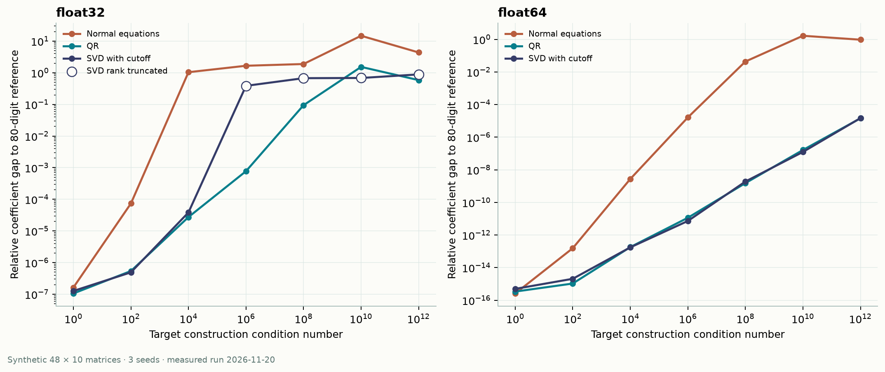
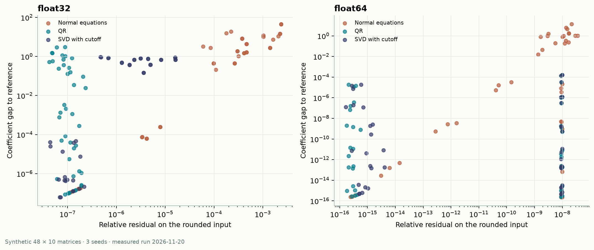

# Least-squares stability lab

**[View the report in your browser](https://Michaelhoang8.github.io/least-squares-stability-lab/)**

A reproducible scientific-computing study of **normal equations, QR, and SVD** across matrix conditioning, noise, rank deficiency, and float32/float64 input-output workflows.

The central distinction is between disagreement with a high-precision solution of the **same rounded input** and failure to recover coefficients from a problem already changed by noise or rounding.



## Published result

The preserved run contains **90 input cases and 270 method measurements**, with all input arrays and returned coefficients available for reconciliation. For the float32 workflow at target condition 10⁴ and no added noise, median reference gaps across three seeds are approximately **1.04** for normal equations, **2.75 × 10⁻⁵** for QR, and **3.84 × 10⁻⁵** for untruncated SVD.

These are measured properties of the selected synthetic cases. NumPy can internally promote precision, and SVD rank truncation deliberately changes the solution; neither detail is hidden. Read the [methods and limits](docs/methods.md).

## Inspect the project

| Artifact | Purpose |
|---|---|
| [Offline visual report](docs/report.html) | Six-section scientific report; download the repository and open locally |
| [Findings memo](docs/findings.md) | Conclusions, recommendations and limits |
| [Methods](docs/methods.md) | Exact metric definitions, reference precision and rank policies |
| [Raw measurements](results/published/measurements.csv) | Per-case status, rank, residual, reference gap and recovery gap |
| [Returned coefficients](results/published/coefficients.csv) | Every successful solver output |
| [Stored inputs](results/published/inputs) / [hash manifest](results/published/input_manifest.json) | Exact rounded matrices, right-hand sides, truth and reference |
| [Environment](results/published/environment.json) | Versions, seeds, BLAS name and run time |
| [Solver implementation](src/stability_lab/core.py) | Construction, methods, reference and diagnostics |
| [Tests](tests/test_numerics.py) | Semantic checks and independent artifact reconciliation |



## Reproduce without replacing the published run

Python 3.13 was used. From the repository root:

```sh
python -m venv .venv
# Windows PowerShell: .venv\Scripts\Activate.ps1
# macOS/Linux: source .venv/bin/activate
python -m pip install -r requirements.txt
python -m unittest discover -s tests -v
python scripts/run_experiment.py --out outputs/my-run
```

Add `--quick` for one seed and three target conditions. Existing output measurements are protected against accidental overwrite. The `outputs/` directory is ignored by Git, so reruns preserve the committed measured evidence.

To check a newly generated run, set `STABILITY_RESULTS` to its directory before running the tests. The default tests reconcile the committed full run. `python scripts/build_report.py` regenerates the charts and report **from the published data**, not from the latest arbitrary rerun.

CI tests the published artifacts, performs a separate quick experiment, and tests that new run. It does not replace the original measurements or require timing thresholds.

## What this demonstrates

- Controlled numerical experiments with known construction spectra and paired seeds.
- High-precision references tied to exact input bytes.
- Clear treatment of ill-conditioning, noise, rank truncation and identifiability.
- Reconciled numerical evidence and reviewable technical communication.

This is an **AI-assisted portfolio study using synthetic matrices**. It is not a claim of production optimization, employer work, or achieved business impact. Sources and implementation-specific precision details are documented in [methods](docs/methods.md).
